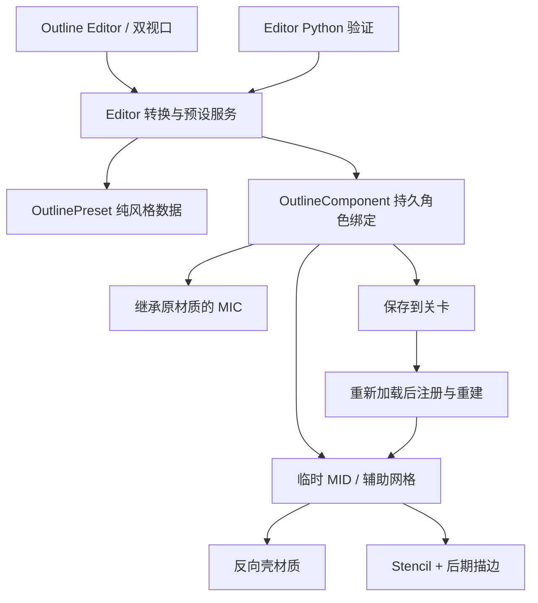

# Outline 技术模块报告

## 目标与交付范围

一个受控骨骼角色、一个 Opaque 材质槽，完成选择、转换、颜色/宽度/方式编辑、原材质对比、预设与关卡保存、独立进程重开。提供反向壳与屏幕空间两种真实渲染方法，以及关闭状态。

这里的转换是 **Outline 增量转换**：生成原材质的子 MIC，完整继承原表面图和纹理引用，再叠加描边。没有把这一结果解释为 Generic / Face / Hair 表面模型已完成。

受控衣物源材质使用角色现有的 `cloth_D` 作为 BaseColor，Normal 使用引擎 `DefaultNormal`。现有 `cloth_N` 的导入设置为 BC7 / LinearColor，尚未确认其编码，因此没有将它猜测为标准切线法线，也没有修改原资源。Normal 继承检查针对这个明确的受控 PBR 源；任意角色的通道解释和贴图映射仍属后续转换工作。

## 模块关系

`NPRRuntime` 仍只依赖 Core、CoreUObject、Engine。窗口、资产创建、编辑器事务与文件保存均在 `NPREditor`；Game 目标不加载编辑器模块。

## 主要文件

| 文件 | 责任 |
|---|---|
| `NPRRuntime/Public/NPROutlinePreset.h` | 枚举、参数单位/范围、风格预设版本 |
| `NPRRuntime/Private/NPROutlinePreset.cpp` | 有限数值、合法范围与方法校验 |
| `NPRRuntime/Public/NPROutlineComponent.h` | 持久目标网格、稳定槽名、原材质、转换材质和设置 |
| `NPRRuntime/Private/NPROutlineComponent.cpp` | 临时网格/MID、Leader Pose、Stencil 分配、后期组件、生命周期清理 |
| `NPREditor/Public/NPROutlineEditorLibrary.h` | UI / Python 共用的反射服务接口 |
| `NPREditor/Private/NPROutlineEditorLibrary.cpp` | 转换、预设应用、保存、原材质恢复、Shader 完成检查 |
| `NPREditor/Private/NPROutlineEditorUI.cpp` | 角色/槽选择、参数工作副本、共享相机双视口、灯光预设和 PNG 导出 |
| `Tools/create_outline_backend_assets.py` | 可重建且有所有权校验的插件材质资产 |
| `Tools/create_outline_workflow_fixture.py` | 独立受控角色/衣物 PBR 槽/场景 |
| `Tools/verify_outline_workflow.py` | 真 RHI、同服务路径、参数变体导出与新进程重开验证 |

以上 C++ 文件位于 `Plugins/PrincipledNPR/Source`。原有标量语义骨架和 S58 风格种子保留，Outline 通过强类型设置单独接入，未伪造完整 Resolver。

## 参数数据

| 字段 | 类型与单位 | 合法域 |
|---|---|---|
| Method | None / InvertedHull / ScreenSpace | 枚举值 |
| Color | 线性 RGB | 每通道有限数值 [0,1] |
| WidthPixels | 输出像素采样距离 | [0,8] px |
| HullWidthCm | 世界空间法线扩张距离 | [0,5] cm |
| DepthBiasCm | 屏幕描边遮挡容差 | [0,5] cm |

两种宽度独立保存，避免切换方法时改变同名数值的单位。Alpha 当前不作为艺术透明度参数开放；描边颜色没有覆盖源表面颜色。

## 两种后端

### 反向壳

建立跟随目标骨骼姿态的辅助 SkeletalMeshComponent。选中槽使用 Hull MID，其他槽使用完全裁剪的 Mask MID。Hull 使用顶点世界法线进行 WPO 扩张，通过 TwoSidedSign 裁掉正面，只保留反向壳。辅助网格关闭碰撞、投影和 Decal 接收。

优点是普通几何深度测试和独立表面描边；宽度为世界空间距离。硬法线/断开的网格可能出现壳缝，开口与穿插会影响轮廓；它不等于按屏幕像素恒宽的描边。

### 屏幕空间

辅助网格只写 Custom Depth / Stencil，选中槽可见，其他槽裁剪。分配器扫描当前 World 已使用的 Stencil 值，再使用空闲 ID，不修改源网格的 Stencil。一个独立 PostProcessComponent 引用屏幕描边 MID。

后期材质位于 UE 5.8 的 **Scene Color After DOF**，在 TSR/TAA 之前采样场景颜色及 CustomDepth/Stencil；保持默认 CustomDepth 时域抖动，让描边与场景一起进入时间抗锯齿。旧版 After Tonemapping 路径已替换，原因和连续帧证据见 [抖动修复报告](Temporal/抖动修复报告.md)。使用 16 个角方向、4 层半径的邻域扩张，只处理目标 ID 外侧，比较邻域目标深度和当前场景深度以抑制被前景遮挡的描边。像素步长使用实际纹理尺寸，输出像素宽度乘以 ViewResolutionFraction 换算到内部渲染尺寸，并将 UV 限制在当前视口边界内。

像素宽度是输出像素单位的邻域距离；离散采样和抗锯齿会影响斜线与极细结构，不能把采样距离宣称为经过全视角标定的精确厚度。当前最大 8 px，未作通用性能预算承诺。

项目配置 `r.CustomDepth=3`。源网格若已写 CustomDepth，会明确诊断，避免与源系统争用相同深度的 Stencil。该条件可通过后续专门的覆盖协议扩展。

## 转换与持久化

1. 校验 Settings、骨骼网格、槽位、保存路径、源材质类型和后端资源。
2. 创建子 MIC，父级直接引用源 UMaterialInterface。原参数名称、纹理通道、静态参数、材质函数和 UV 逻辑由完整继承保持。
3. 新增持久 OutlineComponent，只替换选中槽；保存原材质与转换实例。
4. 窗口用独立参数工作副本预览；属性编辑提交写回场景绑定。
5. 纯风格预设按值应用到绑定。保存预设与关卡后，下一进程依据序列化字段重建临时辅助组件。

辅助网格、后期组件和 MID 均为临时对象，不将一次会话的指针当作持久化。主材质模板以硬引用存入绑定，供后续 Cook 收集。恢复源材质前检查该槽仍由本工具生成实例占用，避免覆盖其他系统后来做出的材质修改。

## 编辑器工作流

Window 菜单的 `Principled NPR · Outline` 打开专用窗口。左侧为选择、转换、Details、预设路径与保存；右侧为独立原材质/NPR 预览场景，共享相机状态与灯光设置。可导出两个视口的 PNG。

预览使用参考姿态；实际关卡运行时辅助网格使用 Leader Pose。预览灯光属于各自 Preview World，不修改用户关卡灯光。原材质为引用对比，不是冻结源 Shader 的历史快照。

## 验证结果

验证日期：2026-10-17；本机 UE 5.8.3、Win64、真实 D3D12 RHI。

| 项目 | 结果与证据 |
|---|---|
| Editor Development | 构建成功，`NPR-Outline-EditorBuild.log` |
| Game Development | 最新 Runtime 变更后重新构建成功，`NPR-Outline-GameBuild.log`；不代表已 Cook |
| 创建阶段 | 最终 35 项检查通过，含受控绑定恢复、固定渲染尺寸、幂等转换、槽位隔离、BaseColor/Normal 引用继承、非法槽拒绝、实际 Shader 编译、预设与场景保存 |
| 独立进程重开 | 最终 15 项检查通过；已保存绑定、材质父级、预设引用、RGBA、宽度和方式恢复，临时渲染组件重建并导出图像 |
| 窗口直接操作 | 正常编辑器菜单打开、选择角色、转换入口、颜色/宽度输入、方式切换、双视口灯光、保存入口与图像导出已操作 |
| 原始像素检查 | 5 项检查通过；关闭状态的 RGB 平均绝对差约 0.176/255；两种方式的宽度增加均产生更大的描边区域；绿色替换红色得到对应输出 |

### 宽度和颜色的实际响应

验证脚本调用编辑器服务，将两个实际渲染缓冲固定为 351×493，再等待渲染并直接读回 PNG；因此不受保存的窗口布局、最大化状态和 DPI 影响。日常窗口保持本机分辨率，普通导出不强制固定尺寸。设置 `(0,0)` 可恢复随窗口变化的缓冲尺寸。

以下是在同尺寸导出图中测得的新增主色像素数量，供判断响应方向；不是艺术质量评分或精确线宽标定。

| 方式/参数 | 新增主色像素 |
|---|---:|
| Hull，0.12 cm，红色 | 845 |
| Hull，0.50 cm，红色 | 2411 |
| Screen，2 px，红色 | 3910 |
| Screen，6 px，红色 | 9650 |
| Screen，6 px，绿色 | 9648（绿色）；红色净变化 -2，属于原表面阈值抖动 |

独立进程会产生光栅和时域差异。验证同时保留全图 RGB 差异、精确描边掩码 IoU，以及允许 1 px 偏差的双向覆盖率。通过条件为双向覆盖均达到 95%、描边面积变化小于 5%；不将两张图逐像素相等作为持久化条件。精确读回的设置、绑定、父材质和预设引用另行检查。

最终精确掩码 IoU 为 0.748；1 px 容差下双向覆盖为 99.80% / 99.56%，面积为 4929 / 4951 px，全图 RGB 平均绝对差为 1.078/255。保留这些不同指标，避免将容差匹配写成逐像素完全一致。

汇总和原始检查记录见 [Validation.json](Validation.json) 及 `Evidence/`。原始生成记录保留 `PixelReviewRequired` 状态，人工图像复核结果记录在汇总文件，不回改原始日志。完整日志位于项目的 `Saved/Logs/`。

### 可查看的图像

正常编辑器中保存预设与场景后的窗口：

直接修改颜色与宽度后的视口响应：

两种方式的原始 PNG、红绿变体与重开图像位于 `Images/Create/` 和 `Images/Reopen/`；详见汇总文件的图像清单。未对导出像素进行修图。

## 对六步产品流程的结论

Outline 已覆盖一个受控槽的选择、转换、调参、对比、保存与重开，证明 Editor 服务 → 数据 → 持久绑定 → 临时渲染资源的链路可以工作。

完整产品继续使用该模块边界。后续需补足：模型注册与选择、跨材质贴图语义映射、统一的类型化风格参数/Resolver、Generic/Face/Hair 后端、预设批量应用、撤销后的窗口同步、资产版本迁移与 Cook。每项应沿用本次受控槽闭环分别验收。

## 边界

- 支持受控 Opaque SkeletalMesh 槽；Masked、Translucent 和任意材质覆盖重建不在本次声明中。
- 选中槽的描边不会自动推广到角色所有槽。跨槽使用预设应重新建立目标绑定。
- 屏幕空间依赖 Stencil；反向壳依赖网格法线和拓扑。
- Hull 的场景线性颜色与屏幕后期颜色不承诺完全相同的视觉响应。
- 本次闭环不证明 Face、Hair、S58 风格映射、完整运行时风格切换或 Cook 已验收。

日常操作见 [操作流程](操作流程.md)，后续功能扩展见 [后续开发链路指导](后续开发链路指导.md)。
