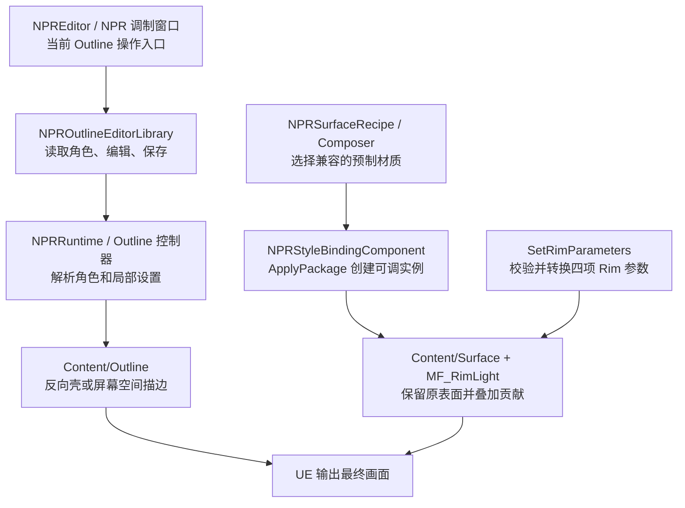

# 项目架构设计

更新日期：2026-10-22。本文说明当前工程怎样工作；功能状态依据已保存的源码、资产和验证记录。本轮整理文档，没有重新运行 UE 渲染测试。

## 1. 我们在做什么

PrincipledNPR 是一个角色风格化材质编辑项目。我们希望使用者能从“轮廓粗一点”“亮边柔和一点”这些画面需求出发调节效果，同时保留模型原有的颜色、法线贴图和自发光。

目前先把能工作的功能做扎实，再逐步统一。我们采用**渐进式组合架构，也就是方案 B**：表面效果共享母材质，描边继续使用各自适合的渲染方法，后续再统一风格管理。

## 2. 当前能做到哪一步

| 部分 | 当前能力 | 还缺什么 |
| --- | --- | --- |
| NPR 调制窗口 | 选择角色、调整 Outline、查看局部材质、保存预设与关卡、导出图片 | Rim 页仍是占位，Surface 没有专用调制页 |
| Outline 描边 | 反向壳、屏幕空间、整角色和局部区域设置、旧单槽流程 | 新增遮罩和分层宽度尚缺对应的完整图像回归；复杂动画等需另验 |
| Rim Light 边缘光 | 四项参数、独立材质、运行时调参，并已接入 Surface | 风格档案中的颜色保存、自动角色绑定与窗口调参尚未接通 |
| Surface 表面组合 | 基础颜色、法线、自发光、Rim 和第二份附加贡献共用一个材质槽；有普通受光与原生 Toon 两个家族 | 任意角色原材质自动转换、MatCap、风格化高光尚未实现 |
| 统一风格管理 | 已有风格数据、材质数据和绑定包类型 | 完整继承解析、参数转换和多种渲染方式的统一执行计划尚未完成 |

“已验证”都有范围。Surface 的最近一次证明来自 UE 5.8.3、Windows、DX12 SM6 的静态球体；不能据此宣布角色动画、阴影、打包和性能全部通过。完整入口见[功能状态](../docs/reference/status.md)。

## 3. 把工程分成四件事看

1. **记录想要的外观。** 例如边缘光多宽、描边什么颜色。参数需要固定名称、单位和默认值。
2. **确定参数写到哪里。** 把外观参数换成具体材质接受的数值。比如 Rim 的程序接口用弧度，而材质编辑器显示度数。
3. **让画面真正变化。** 使用已经保存的材质、材质函数或描边资源完成计算。
4. **提供编辑与保存。** 窗口负责选择、预览、报错和保存，不另外复制一套渲染算法。

这就是我们保留的“外观参数 → 参数映射 → 材质与渲染实现”顺序。一个参数的语义名称，不一定就是材质节点上的输入名称。

## 4. 表面效果怎样组合

母材质可以理解为一份可重复使用的材质模板；材质函数是模板里可重复调用的一段计算。我们不为每种效果组合重新复制完整材质。

当前表面计算分工如下：

| 负责的内容 | 当前实现 | 保留关系 |
| --- | --- | --- |
| 原有表面 | `MF_NPRSurfaceInputs` | 输出基础颜色、切线法线和基础自发光 |
| 边缘光 | 原有 `MF_RimLight` | 输出独立的亮边贡献，不改原算法 |
| 第二份附加颜色 | `MF_NPRAdditiveColor` | 使用自己的颜色和强度，作为最小扩展示例 |
| 合成自发光 | `MF_NPRComposeEmissive` | 基础自发光 + Rim + 附加贡献 |
| 最后的受光方式 | `M_NPRSurface_DefaultLit` 或 `M_NPRSurface_Toon` | 两个家族复用上述函数 |

`Recipe` 是预制组合说明，记录母材质支持哪些效果、每个参数由谁负责以及组合顺序。`Composer` 是选择器，按请求选出兼容的 Recipe，检查后交给现有绑定组件。

实际顺序是：选择 Recipe → 生成绑定包 → `ApplyPackage` 绑定材质 → 得到同一个槽的运行时材质实例 → 更新参数。运行时材质实例简称 **MID**，可以理解为“当前对象使用的一份可调材质”。

Rim 继续通过原有 `SetRimParameters` 修改这个 MID。强度为 0 是有效关闭值；它并不保证显卡完全省去该效果的计算。

现有 Toon 家族引用工程中的未标定探针资源。Toon + Rim 已在同槽球体上显示，不等于完整 Toon 风格系统已经完成。

### 共用表面函数中的计算

下面直接使用材质参数和节点的名字。`TextureSample(UV0)` 表示按模型第一套纹理坐标读取贴图；法线贴图经 UE 的 Normal 采样器解码后再使用。

```text
BaseColor = BaseColorTexture(UV0).RGB × NPR_BaseColor.RGB
NormalTS = Normalize(Lerp((0,0,1), NormalTexture解码值, NPR_NormalStrength))
BaseEmissive = EmissiveTexture(UV0).RGB × NPR_EmissiveColor.RGB × NPR_EmissiveScale
AdditionalEmissiveContribution = NPR_AdditionalEmissiveColor.RGB × NPR_AdditionalEmissiveScale
Emissive = BaseEmissive + RimColorContribution + AdditionalEmissiveContribution
```

`NormalTS` 是相对于表面的局部朝向；`(0,0,1)` 表示没有凹凸的平坦法线。`Lerp` 在法线强度 0 时取平坦值，1 时取贴图值，随后 `Normalize` 保留方向。Rim 的角度、过渡和正面门控公式见 [Rim Light 介绍](rim_light_introduction.md)，不会用这条法线公式悄悄改变原 Rim 的默认朝向。

## 5. 描边为什么独立

两种描边需要的工作不同。反向壳需要额外绘制外扩模型；屏幕空间描边需要读取画面深度和区域标记。这些工作继续交给原有 Outline 控制器，不强行塞进表面母材质。

因此，同一个角色可以同时拥有“表面材质效果”和“独立描边”。未来统一风格管理只负责协调参数和资源，不要求所有效果采用同一种计算方法。算法细节见 [Outline 介绍](outline_introduction.md)。

### 当前调用关系



图中列出当前代码与资产的真实关系。Rim 和 Surface 还没有接入 NPR 调制窗口的实际调参流程，所以单独画出程序绑定入口。

## 6. 代码和资产放在哪里

工程目前有一个宿主模块和两个插件 C++ 模块。下表中的参数、绑定、描边等是职责划分，不表示新增了同名模块。

| 位置 | 职责 |
| --- | --- |
| `Source/PrincipledNPR` | 让 UE 工程能够加载和构建 |
| `Plugins/PrincipledNPR/Source/NPRRuntime` | 参数与数据类型、材质绑定、Surface 选择、Outline 运行逻辑 |
| `Plugins/PrincipledNPR/Source/NPREditor` | NPR 调制窗口、预览、转换服务、预设与关卡保存 |
| `Plugins/PrincipledNPR/Content/Outline` | 两种描边材质和辅助资源 |
| `Plugins/PrincipledNPR/Content/RimLight` | 原有 Rim 函数、材质和预览实例 |
| `Plugins/PrincipledNPR/Content/Surface` | 共用函数、两个母材质家族、Recipe 和预览资产 |
| `Content/NPR` | 工程角色配置、测试场景和原生 Toon 探针 |
| `Tools` | 构建、资产创建、只读审查、验证和文档生成工具 |
| `Documentation` | 仍在使用的参数契约、研究依据和原始验收记录 |
| `docs` | 当前维护的中文说明；本文和另外四份文档是主要阅读入口 |
| `openspec` | 项目约束、已有功能规范和真实开发变更的计划 |

## 7. 数据分别保存什么

风格只记录“想要什么外观”；角色绑定记录“哪一个网格、哪一个材质槽”；后端资源记录“实际用哪份材质”。三者分开，才能让同一风格用于不同角色。

Outline 的基础预设目前只保存基础描边设置；角色和局部区域规则随关卡保存。运行中的 MID、辅助网格和预览隔离状态不应当作可分享的风格资产。

## 8. 后续工作与阅读顺序

优先补齐现有功能的角色工作流、保存和验证，再扩展 Toon、MatCap、高光等效果。统一风格解析、多种渲染方式协调、脸部与头发专用模型需要各自设计和验收。

- 开发前阅读[项目开发说明与约束](项目开发说明与约束.md)。
- 实际操作阅读[NPR 调制插件使用说明](NPR调制插件使用说明.md)。
- 单项功能阅读 [Outline](outline_introduction.md) 和 [Rim Light](rim_light_introduction.md)。
- 技术证据见 [Surface 实施记录](Surface/Implementation.md)和[现有验证状态](../docs/reference/status.md)。

早期的 12 份重复说明已合并归档，位置与恢复线索见[历史资料索引](../docs/reference/legacy.md)。新文档描述当前状态，不把历史计划改写成已经完成的功能。
