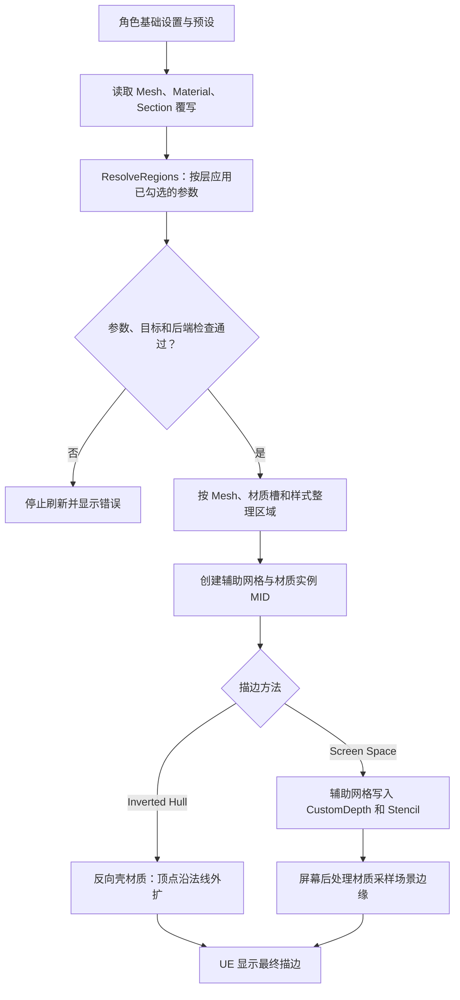

# 渲染管线

本插件当前没有独立的 `Shaders/` 源码目录。Outline 通过 UE 材质资产实现；`Tools/create_outline_backend_assets.py` 是其可读构造来源，Screen HLSL 写在材质 Custom 节点中。HLSL 是 GPU 执行的着色程序语言；Custom 节点允许把一段 HLSL 放入材质图。

## Outline 数据流

这个功能从角色设置进入区域解析，再交给现有的两种描边材质路径：

图中的 MID 是运行中可调参数的材质实例。Screen Space 的屏幕后处理材质仍属于 UE 材质资产；当前插件没有独立的 `.usf` 渲染 Pass。

WPO 是 World Position Offset，即移动顶点的位置。Hull 用它沿法线外扩，然后显示壳的背面。Screen 则借 CustomDepth/Stencil 保存角色区域的深度和编号，再向区域外采样画线。Stencil 可理解为“给区域写一个整数标签”。二者的宽度单位与算法不同，详见[Outline](../features/outline.md)。

Screen 放在景深之后、时间抗锯齿之前。TSR 是时间超分辨率，TAA 是时间抗锯齿，都使用前后帧信息；若在它们之后才画硬边，深度采样的逐帧偏移可能直接变成闪动。既有修复保留正常 jitter（采样微偏移），让描边一起进入时域处理。

## 后续实现原则：材质节点优先

我们把 UE 材质节点图看作 Shader 的一种写法。UE 会把节点组合编译成 HLSL，再生成显卡可执行的程序；所以用材质节点实现，也是我们在写 Shader。[Epic 的材质说明](https://dev.epicgames.com/documentation/unreal-engine/essential-unreal-engine-material-concepts?lang=en-US)介绍了这个过程。

我们先选能让效果容易看懂、方便美术调节的实现：简单计算用节点；一段节点网络要在多处使用时，优先整理成 Material Function（材质函数，一组可重复使用的节点）。Base Color、颜色调整和常见的遮罩混合都适合从这里开始。

只有遇到明确需要时，我们才把计算写成 HLSL。比如所需计算没有合适的材质节点，节点连线已经难以读懂，或者某段数学算法需要在多种材质间共用并单独维护。Custom 节点可以直接写 HLSL，也能引用外部 Shader 文件；但 Epic 提醒，Custom 节点可能挡住引擎对常量的简化，导致指令数高于等价的内置节点，因此不能只为“源码看起来独立”而改写。[Custom 节点说明](https://dev.epicgames.com/documentation/en-us/unreal-engine/custom-material-expressions-in-unreal-engine)

`.ush` 可以按本项目约定存放共用 HLSL 函数，再由材质 Custom 节点引用；它仍然属于材质 Shader 的一部分，自己不会新增渲染阶段。若效果需要材质之外的屏幕图像、计算着色器或独立绘制阶段，才考虑 `.usf` 和独立 Shader Pass。`.usf` 文件本身也不会自动运行：UE 还需要 C++ 注册 Shader、传入参数和资源，并把工作加入渲染流程。RDG（渲染依赖图）是 UE 用来登记和安排这些渲染工作及资源的接口。[Global Shader 说明](https://dev.epicgames.com/documentation/en-us/unreal-engine/adding-global-shaders-to-unreal-engine)和[RDG 指南](https://dev.epicgames.com/documentation/en-us/unreal-engine/render-dependency-graph-in-unreal-engine)有相应的接入示例。

对我们来说，判断顺序是：材质节点能清楚表达，就保留节点实现；节点图重复或难读，先看材质函数是否合适；确有算法复用或表达能力需求，再抽出 HLSL；效果需要材质无法提供的渲染阶段和资源时，才研究独立 Pass。当前 Outline 继续使用已有材质资产和 Custom 节点。未来若抽出其中的计算，应逐段验证编译结果与画面，不因建立独立源码目录而重写整套实现。

## 构建与验证边界

材质脚本只操作带本项目归属标记的资产。修改脚本后应按现有工具更新实际 `.uasset`，确认编译完成，再做画面回归；不能仅因文本代码改变就宣布材质已更新。普通文档构建不会执行该脚本。

跨引擎版本升级时重点核对后处理插入位置、SceneTexture 编号/缓冲尺寸、预曝光和时间上采样顺序。预曝光是引擎为控制亮度数值采用的缩放，不应在材质已自动处理时再次手工乘。

S58 语义后端的曲线生成、标定和包构造仍待实现；不可把这里的 Outline Pass 说明套到表面 Toon Lighting。
