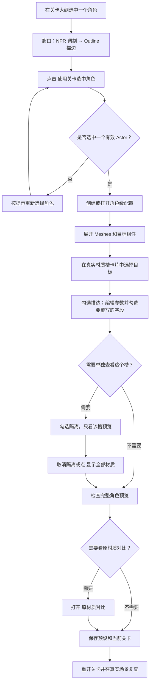

# 快速开始：为角色添加描边

前提是[安装](./installation.md)完成且 Outline 插件资产可加载。

1. 在关卡大纲中只选择一个角色对象。它应包含普通静态网格或骨骼网格组件；组件就是角色身上的身体、头发、衣服等模型对象。
2. 打开 **窗口 → NPR 调制 → Outline · 描边**，点击“使用关卡选中角色 / Use Selection”，再点“创建 / 打开角色级配置”。
3. 在“描边方式 / Method”选择方法。Inverted Hull（反向壳）通过把模型外扩一点来画线；Screen Space（屏幕空间）在画面上沿角色边缘画线。需要整个角色只有统一外轮廓时，选 Screen Space，再选“统一外轮廓 / UnifiedSilhouette”。
4. 从默认细线开始：壳宽度为 0.1 cm，屏幕宽度为 1.25 px（像素）。只想改变头发等局部区域时，在 `Meshes` 展开组件，按真实材质槽列表勾选描边；点击该槽“参数”，先勾选要覆写的字段，再改 `Values`（本层设置）。勾选“隔离”可单独查看这一槽。材质槽是模型上指定使用哪份材质的位置。
5. 对比右侧描边视图和左侧原材质。聚焦、Studio/Warm/Raking 只调整预览；角色预览是参考姿势，动画需在真实关卡验证。
6. 选择或[保存预设](../editor/presets.md)，同时保存角色所在关卡。重开关卡检查局部规则；需要留档时“导出双视口 PNG”。

下面的流程对应我们实际的角色级操作。隔离只临时改变预览，不会替代保存角色设置：

这张图是我们从 UE 5.8.3 编辑器当前窗口直接采集的，展示 Outline 页面、真实材质槽卡片和角色预览。原来的操作配图仍保存在 `Documentation/Outline/Guide/01-overview.png`，供查阅旧版操作记录；本手册以当前窗口为准。渲染效果对比见 [Outline 页面](../features/outline.md)。

如果窗口报错，先按错误提示检查设置。常见原因是：统一外轮廓模式中设置了不同局部样式；选择的网格分段不能单独隔离；屏幕空间描边开启了只适用于反向壳的局部宽度选项。详细限制见 [Outline](../features/outline.md)。

工具栏“原材质对比”可打开或关闭左侧原材质视图；默认只显示 Outline。新增材质槽列表、隔离与预览布局的验证状态见 [Outline](../features/outline.md)。
