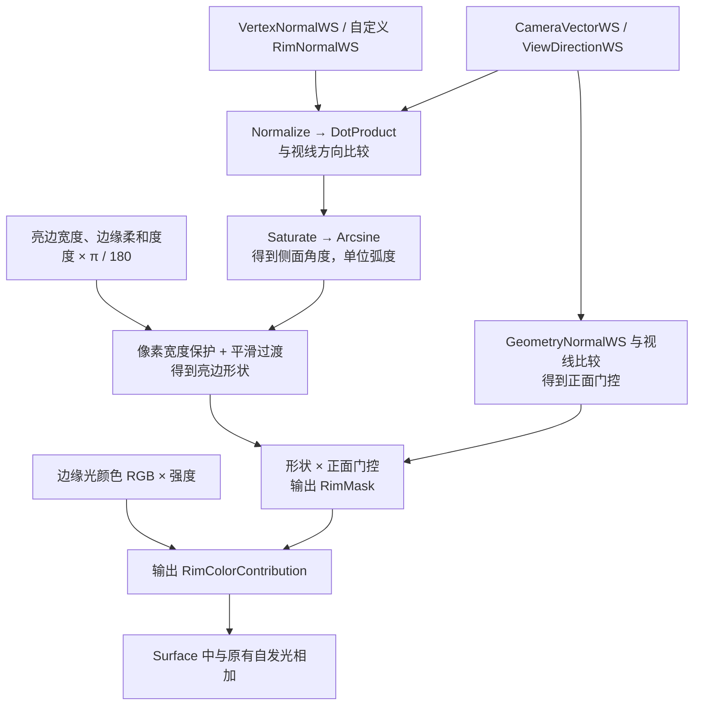

<!-- Generated from Documentation/rim_light_introduction.md. Edit the original, then run npm run docs:generate. -->

# Rim Light 边缘光介绍

我们用 Rim Light 在侧对相机的表面增加一圈亮边，突出角色体积。本文先讲现有算法，再讲实际使用。更新日期：2026-10-22；本轮只整理文档，没有重新运行 UE 渲染。

## 1. 算法：根据表面朝向产生亮边

### 怎样判断“边缘”

我们比较表面朝向与视线方向：越正对相机，越接近物体中间；越侧对相机，越接近轮廓。这里用相对于侧面的角度描述，侧对相机是 0°，正对相机是 90°。

“亮边宽度”决定亮边覆盖到多大的角度，“边缘柔和度”决定边界附近多大范围逐渐变淡。计算使用原有 `MF_RimLight` 材质函数，没有因为接入 Surface 而改写算法。

例如宽度 8°、柔和度 2°，忽略像素过滤时：6°以内保持完整形状权重，6°–10°平滑减弱，10°以外为 0。这里的“完整”仍需乘颜色、强度和正面门控，并不保证一定显示纯白。

### 用 UE 材质节点的名字写出公式

先看这些量分别从哪里来，不需要先记住数学字母：

| 公式中的名字 | UE 中的来源 | 直观含义 |
| --- | --- | --- |
| `RimNormalWS` | 函数输入，默认 `VertexNormalWS` | 用来计算亮边的世界空间表面朝向 |
| `GeometryNormalWS` | 函数输入，默认 `VertexNormalWS` | 用来检查正反面的几何朝向 |
| `ViewDirectionWS` | 默认 `CameraVectorWS` | 从当前表面点指向相机的方向，不是相机统一的朝前方向 |
| `Normalize` | 同名节点 | 只保留方向，把向量长度变为 1 |
| `DotProduct` | 同名节点 | 比较两个方向有多一致；正对为 1，垂直为 0，反向为负 |
| `Saturate` | 同名节点 | 把数值限制到 0–1 |
| `Arcsine` | 同名节点 | 把点积换成相对侧面的角度，输出单位是弧度 |

第一步，把表面朝向换成角度：

```text
N = Normalize(RimNormalWS)
G = Normalize(GeometryNormalWS)
V = Normalize(ViewDirectionWS)

表面朝向值 = DotProduct(N, V)
侧面角度 γ = Arcsine(Saturate(表面朝向值))
亮边角宽 ω = 亮边宽度（度）× π / 180
艺术柔和半宽 = 边缘柔和度（度）× π / 180
```

默认 8° 约为 0.139626 弧度，2° 约为 0.034907 弧度。`Arcsine(0)=0` 对应侧面，`Arcsine(1)=π/2` 对应正面。所有参与比较的角度必须使用同一单位。

第二步，给过渡保留至少半个像素的宽度。`DDX`、`DDY` 是 UE 材质节点，用来估计一个值在相邻横向、纵向像素间的变化：

```text
像素半宽(x) = Max(0.5 × (Abs(DDX(x)) + Abs(DDY(x))), 0.00001)
有效柔和半宽 w = Max(艺术柔和半宽, 像素半宽(γ))
过渡位置 u = Saturate((γ - ω + w) / (2 × w))
平滑过渡 = u × u × (3 - 2 × u)
亮边形状 = 1 - 平滑过渡
```

这相当于一条从完整亮边平滑降到 0 的曲线。图中实际用加、减、乘、除和 `Saturate` 节点搭出，没有调用额外 HLSL 文件。

第三步，独立处理正反面，再合成颜色：

```text
几何朝向 q = DotProduct(G, V)
正面过渡半宽 a = 像素半宽(q)
正面位置 v = Saturate((q + a) / (2 × a))
正面门控 = v × v × (3 - 2 × v)

RimMask = 亮边形状 × 正面门控
RimColorContribution = 边缘光颜色.RGB × 边缘光强度 × RimMask
Emissive = BaseEmissive + RimColorContribution + AdditionalEmissiveContribution
```

`RimMask` 是亮边覆盖权重，`RimColorContribution` 是最终额外颜色。`Saturate` 只限制权重，最终自发光相加不做 0–1 截断，保留高于 1 的亮度。

在正面门控接近 1、像素过滤小于艺术柔和度时，默认角宽 8°、半宽 2° 的计算如下：

| 侧面角度 | 过渡位置 u | 亮边形状 | 看起来怎样 |
| --- | --- | --- | --- |
| 6° | 0 | 1 | 完整形状权重 |
| 8° | 0.5 | 0.5 | 过渡中点 |
| 10° | 1 | 0 | 已经没有亮边贡献 |

最后还要乘颜色和强度；基础强度为 0 时，上述位置全部输出 0。这个表说明角度过渡，不把屏幕显示亮度当成严格线性数值。



对应来源：`Tools/create_rim_light_assets.py` 的 `band` 和 `MF_RimLight` 构造部分；Surface 合成见 `Tools/create_surface_master_assets.py`。这是算法流程图，不是新渲染验收图。

### 怎样避免锯齿和背面发亮

算法会根据相邻像素的变化保留最小过渡，所以柔和度为 0 仍有必要的抗锯齿处理。几何表面朝向另做一次正面检查，抑制背面亮边。自定义朝向输入必须有效、非零。

默认使用顶点世界法线，也就是模型顶点在世界中的表面朝向。Surface 的法线贴图不会自动改写这项 Rim 默认输入。

### 怎样加入原有材质

```text
Rim 贡献 = 边缘光颜色 × 边缘光强度 × 亮边形状权重 × 正面门控
Surface 最终自发光 = 原有自发光 + Rim 贡献 + 其他附加贡献
```

自发光可以理解为一份额外颜色贡献。它不会自动获得灯光方向或投射阴影，因此不是“真实灯光照出的边缘反光”。普通遮挡仍会挡住不可见表面；可见表面上的投射阴影不会自动压暗这份贡献。

基础颜色、法线和原有自发光分别保留。不要把 Rim 输出直接接管一个已有材质的全部自发光；应使用现有 Surface 合成入口或明确相加。

## 2. 当前实现与真实效果

独立 Rim 材质、四项参数契约和 C++/MID 调参为**已实现并验证**。完整风格保存、角色自动绑定和调制窗口流程仍为**开发中**。

| 宽度变化示例 | 颜色变化示例 |
| --- | --- |
|  |  |

来源：2026-10-22，UE 5.8.3 / DX12 SM6，512 × 512 受控球体的真实渲染导出，不是窗口截图，也不代表角色和阴影已全面验收。

## 3. 使用：先在材质实例观察

1. 在内容浏览器开启插件内容显示。
2. 打开 `Principled NPR Content / RimLight / MI_RimLight_Preview`。
3. 勾选需要覆盖的参数，先改宽度，再改柔和度，最后改颜色和强度。
4. 比较细亮边、较宽亮边、硬过渡和软过渡，确认自己需要的方向。
5. 验证后保存自己的实例，不必改动基础函数。

基础材质的强度默认是 0，因此默认关闭；预览实例覆盖为 1，用来方便观察。**NPR 调制窗口的 Rim 页仍是占位**，不能在该页通过滑条修改当前角色。

## 4. 四项参数

| 材质中显示的名字 | 默认值 | 硬范围 | 建议先尝试 |
| --- | --- | --- | --- |
| 亮边宽度 | 8° | 0°–90° | 1°–35° |
| 边缘柔和度 | 2°，过渡半宽 | 0°–90° | 0°–10° |
| 边缘光强度 | 0；预览覆盖 1 | 有限非负值 | 0–2 |
| 边缘光颜色 | 线性 RGB 白色 `(1,1,1)` | 每通道有限非负值，忽略 Alpha | 每通道 0–1 |

滑条建议范围不等于硬范围。程序入口会拒绝非法数值，而原生材质实例编辑不会自动调用项目校验。强度 0 和黑色都是有效关闭方式；“恢复继承”是移除当前层的参数覆写。

柔和度大于亮边宽度时，可能没有完整强度区。角度宽度不是固定像素厚度，模型形状、距离和视角会影响画面；颜色亮度与强度也共同决定明暗。

## 5. 在 Surface 中保留原有表面

打开 `Surface / MI_NPRSurface_Preview`。它继承 `M_NPRSurface_DefaultLit`，可以分别指定基础颜色、法线、自发光输入，再调整原有四项 Rim 参数。

角色接入时，需要明确填入原材质使用的贴图与数值；不会自动分析任意角色原材质。透明裁切、顶点变形等额外逻辑也不会自动迁移。详细说明见 [Surface 材质组合](../features/surface-material.md)。

2026-10-22 的受控验证中，切换 Rim 前后 BaseColor 和 Normal 缓冲差值均为 0；原有自发光、Rim 和第二份附加贡献的 HDR 相加误差约 0.885%，小于该测试 1% 门限。原生 Toon + Rim 也在同一材质槽中显示；Toon 使用的是既有未标定探针 Profile。

## 6. 程序和蓝图怎样调参

先用 `ApplyPackage` 绑定已经接好 Rim 的材质，或经 Surface Composer 选择兼容 Recipe 后再绑定。随后在同一 MID 上调用 `SetRimParameters`，不用每次重新创建材质。

程序结构 `FNPRRimParameters` 的两个角度用**弧度**，材质实例的中文参数用**度数**；专用接口负责转换。蓝图同名节点调用相同实现，读取返回值和错误说明。

```cpp
FNPRRimParameters Rim;
Rim.RimGrazingAngleRad = FMath::DegreesToRadians(25.0);
Rim.RimEdgeHalfWidthRad = FMath::DegreesToRadians(2.0);
Rim.RimPeakScale = 1.0f;
Rim.RimColor = FLinearColor(1.0f, 0.2f, 0.1f);
FString Error;
const bool bUpdated = Binding->SetRimParameters(Rim, Error);
```

任何输入非法、目标槽缺少参数、类型不符或材质已被其他系统替换，整次更新失败并保留旧值。结束时 `RestoreMaterials` 只恢复仍由该组件持有的材质，不覆盖外部修改。完整接口记录见[动态调参说明](/generated/source/Documentation/RimLight/RuntimeBinding.md.txt)。

## 7. 限制、验证与后续工作

- 当前贡献不自动响应灯光方向和投射阴影，最终显示还受曝光、雾和色调映射影响。
- 使用像素导数做抗锯齿，只能用于像素阶段，不能接到顶点位移计算。
- 默认朝向和几何正面检查保留，未包含双面翻法线的完整工作流。
- 完整风格解析、颜色的风格档案存储、角色自动绑定和窗口调参仍需实现。
- 角色动画、多 LOD、时域、Cook 和性能需要各自验收。

2026-10-22 的三项 Rim 自动化、八项图像/自动化门禁及反射调用检查有各自记录；Surface 最近一次验证另行证明同槽组合。证据见[参数与材质契约](/generated/source/Documentation/RimLight/MaterialParameters.v1.json)、[Rim 执行记录](/generated/source/Documentation/RimLight/ImplementationValidation.json)、[图像指标](/generated/source/Documentation/RimLight/BindingValidation/ImageMetrics.json)和 [Surface 验证](/generated/source/Documentation/Surface/ImplementationValidation.json)。

源码入口为 `NPRRimParameters`、`NPRStyleBindingComponent` 与 `Tools/create_rim_light_assets.py`。修改算法、参数、材质组合或操作后，同步本文、[开发约束](../developer/项目开发说明与约束.md)和[状态清单](../reference/status.md)，避免旧验证范围被扩大解释。
